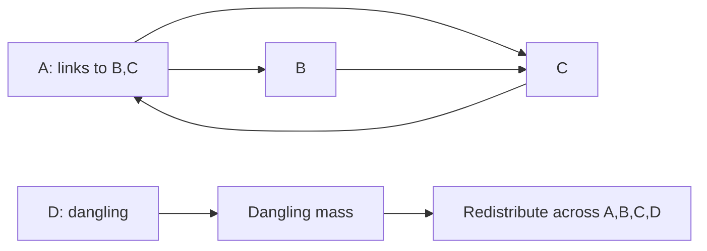

# Lab 05 — PageRank

> **Your mission:** Calculate page importance on a directed graph and observe how rank changes over repeated iterations.

**You will practice:** Rank propagation, normalization, damping, dangling nodes, convergence and MapReduce-style computation.

## 1. Get ready

From the repository root:

```bash
make lab-pagerank
```

[Student task file](https://github.com/OrPerets/postgres-data-engineering-lab/blob/main/labs/05-pagerank/student_tasks.py) · [Full assignment](https://github.com/OrPerets/postgres-data-engineering-lab/blob/main/labs/05-pagerank/STUDENT_ASSIGNMENT.md)

## 2. Predict rank flow

Start with:

```text
A → B, C
B → C
C → A
```

Each page initially has rank `1/3`. A splits its contribution across B and C, while B and C send their whole ranks to one destination.

**Predict:** Which page ranks highest after the first iteration?

## 3. Run the example

```bash
cd labs/05-pagerank
python pagerank_demo.py
```

**Checkpoint:** First iteration should give A=1/3, B=1/6, C=1/2 (without damping).

## 4. Add dangling nodes and damping

Add D, a page without outlinks. Use damping `d=0.85`:

```text
new_rank(p) = (1-d)/N + d*(incoming_contributions + dangling_mass/N)
```

**Predict:** Why does rank mass disappear if a dangling node is ignored?

**Checkpoint:** The four-page first iteration should approximately be A=.303125, B=.196875, C=.409375, D=.090625. The ranks must sum to 1.

## 5. Implement and validate

Complete contribution mapping, shuffle grouping, dangling mass, one damped update and convergence in `student_tasks.py`.

```bash
python -m unittest tests.test_demo -v
python -m unittest discover -s tests -v
```

Student tests intentionally fail until completed.

## 6. Performance experiment

```bash
python benchmark.py --nodes 1000 10000 --workers 2 4 --iterations 12 --trials 3
```

Record measured times, speedup and efficiency. [Read the performance assignment](https://github.com/OrPerets/postgres-data-engineering-lab/blob/main/labs/05-pagerank/PERFORMANCE_ASSIGNMENT.md).

**Explain:** Why can two or four worker processes be *slower* on small graphs? How is a single Codespace different from a multi-node distributed cluster?

**Next:** [Lab 06 — TF-IDF](06-tfidf.md).


## Visual walkthrough — One rank update



### First iteration with damping 0.85

Start with four pages at 0.25 each and links A→B,C; B→C; C→A; D→none.

| Page | Incoming link contribution | New rank |
|---|---:|---:|
| A | 0.250 | 0.303125 |
| B | 0.125 | 0.196875 |
| C | 0.375 | 0.409375 |
| D | 0 | 0.090625 |
| **Total** | **0.750** | **1.000000** |

The missing 0.25 link contribution is dangling mass from D. Teleportation and damped redistribution preserve the total rank.

**Predict:** What would happen to the sum of ranks if the algorithm simply discarded D's rank?

**Try it:** Run `python pagerank_demo.py` and compare the first iteration to this table. Then implement the functions in `student_tasks.py`.

### Performance: what is and isn't measured

The optional benchmark compares sequential PageRank with multi-process mapping on **one Codespace host**. It does not benchmark a real multi-node cluster. Explain process startup, communication overhead and centralized reduction before interpreting any speedup.
